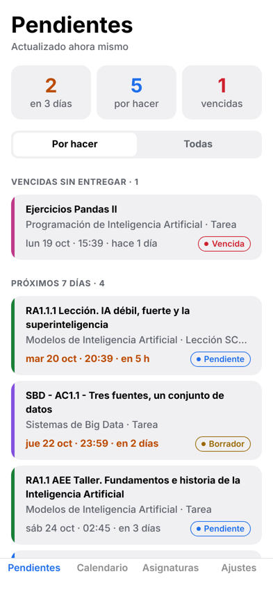
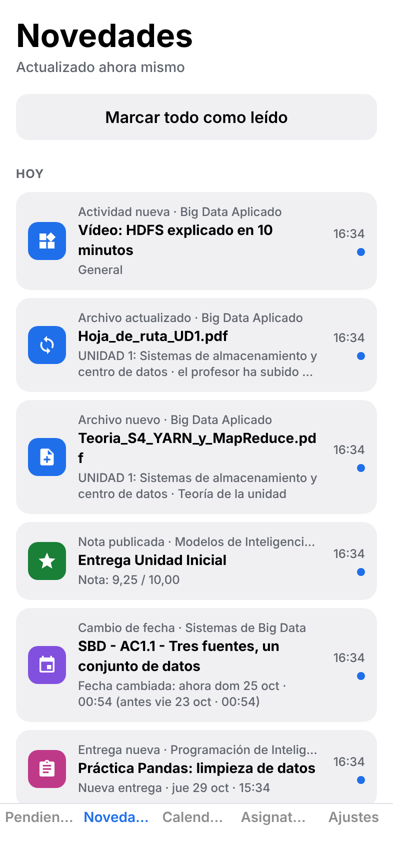
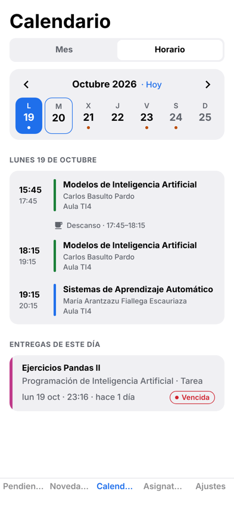
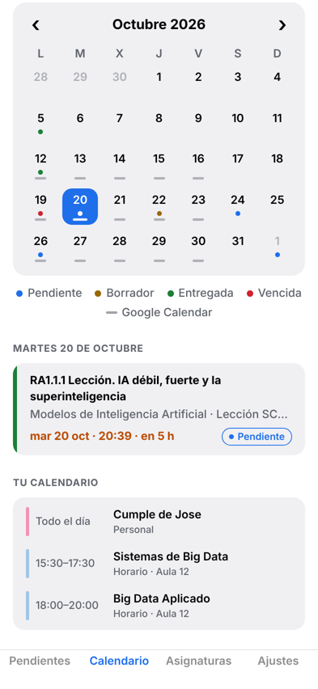
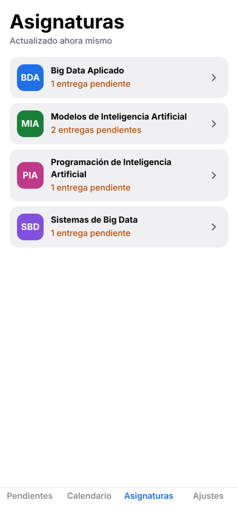
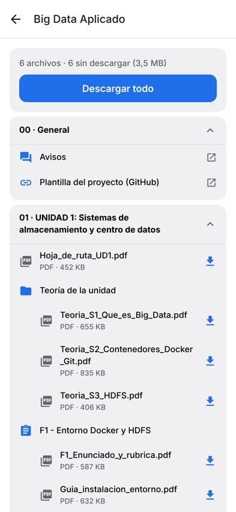
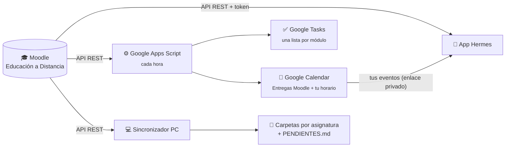

<div align="center">


# Hermes

**El mensajero de tu FP a distancia.**
Entregas, apuntes y horario del Moodle de la Junta de Andalucía en el bolsillo, sin entrar asignatura por asignatura.


</div>

---

## ¿Por qué?

En la FP a distancia todo pasa por el aula virtual: cada módulo tiene sus unidades, sus PDFs, sus tareas con fecha y sus lecciones SCORM. Saber qué tienes que entregar implica **entrar en cada asignatura, una por una**, descargar los archivos a mano y apuntar las fechas en otro sitio.

**Hermes hace ese trabajo por ti.** Habla directamente con la API de Moodle (la misma que usa la app oficial), junta todo en un solo sitio y lo lleva donde ya miras cada día: tu móvil, Google Tasks y Google Calendar.

## Capturas

<p align="center">
  
  
  
</p>
<p align="center">
  
  
  
</p>
<p align="center"><sub>Pendientes · Novedades · Horario del día · Calendario del mes · Asignaturas con su profesor · Contenido de una asignatura (datos de ejemplo)</sub></p>

## Qué hace

### 📱 La app (Android y iPhone)

- **Pendientes.** Todas las entregas de todos los módulos en una lista: vencidas, próximos 7 días, más adelante. Cada una con su estado (*pendiente, borrador, entregada, vencida*), la **nota** si ya está corregida y cuánto falta. Lo que vence en menos de 3 días se marca en naranja y sale en el globo de la pestaña.
- **Novedades.** Lo que ha cambiado desde la última vez, en todas las asignaturas: **apuntes nuevos**, archivos que el profesor ha **actualizado**, **actividades** y **entregas nuevas**, **notas publicadas** y **cambios de fecha**. Con globo de no leídas; al tocar una, te lleva al archivo, la tarea o la asignatura.
- **Horario.** Desliza en Calendario y ves **las clases del día**: hora, módulo, profesor y aula, con el descanso y la clase en curso marcada como "AHORA". Arriba, una tira con los días de la semana para saltar a ayer, mañana o cualquier otro día. Los **festivos y vacaciones** del calendario escolar aparecen como "No hay clase" con el motivo. Debajo salen las entregas de ese día y el resto de tus eventos de Google.
- **Calendario.** Vista de mes con un punto por entrega, del color de su estado, y **tu Google Calendar dentro**: horario de clases y eventos personales en la agenda de cada día.
- **Asignaturas.** Cada módulo con su profesor, sus bloques y actividades, como en Moodle. Los archivos se **descargan al móvil** (uno a uno o "Descargar todo") y se abren sin conexión.
- **Widgets (Android).** *Próximas entregas*, con cuánto falta para cada una, y *Clases de hoy*, con la que toca **ahora**; si ya han acabado, enseña las de mañana. Se ven sin abrir la app y se actualizan solos.
- **Visor integrado.** Los PDF e imágenes se ven dentro de la app, con zoom; Word, PowerPoint o ZIP se abren con la app del móvil que corresponda.
- **Detalle de entrega.** Enunciado, fechas de apertura, entrega y cierre, estado, nota y archivos adjuntos.
- **Login desde el móvil.** Inicias sesión con tu usuario de la Junta (CAS) y la app recibe el token sola.
- **Sin servidor propio.** Habla directamente con Moodle y funciona sin conexión con lo último que descargó.

### ✅ Google Tasks + 📅 Google Calendar (Apps Script)

Un script que vive en **tu cuenta de Google** y se ejecuta solo cada hora:

- Crea cada entrega en **la lista de Google Tasks de su asignatura**, con la fecha y hora exactas en las notas. Si ya la tenías apuntada a mano, **la reconoce y la reutiliza**.
- Cuando entregas en Moodle, **la marca como completada**.
- Crea un evento a la hora exacta en el calendario **"Entregas Moodle"**, con avisos 1 semana, 5 días, 3 días, 1 día, 6 h y 2 h antes.
- Le sirve tus eventos de Google Calendar a la app con un enlace privado.

Cada parte es **opcional e independiente**; la app no necesita el script para nada.

### 💻 Sincronizador para el PC

Un script de Python que **descarga todo el material a tu ordenador**, ordenado por asignatura y bloque, con un `PENDIENTES.md` y un calendario `.ics`. Se puede programar para que se ejecute solo.

## Cómo encaja todo



## Empezar

### 1. Instalar la app

**Android.** Descarga el APK de la [última versión](https://github.com/hehedaniel/hermes/releases/latest) e instálalo; Android te pedirá permitir "orígenes desconocidos". Abre **Hermes → Ajustes → Iniciar sesión en Moodle** y entra con tu usuario de la Junta. Si el móvil pregunta con qué app abrir el enlace, elige **Hermes**.

**iPhone.** Abre **[hehedaniel.github.io/hermes](https://hehedaniel.github.io/hermes)** en Safari y pulsa **Compartir → Añadir a pantalla de inicio**: queda un icono como el de cualquier app. La primera vez hace falta un ordenador para sacar el token; los pasos salen en **Ajustes → ¿Cómo consigo el token?**. En la versión web los archivos se abren en el navegador en lugar de guardarse en el móvil; todo lo demás es igual.

<details>
<summary><b>Compilar el APK tú mismo</b></summary>

Se compila en la nube de Expo (EAS), gratis; solo necesitas una cuenta en [expo.dev](https://expo.dev/signup).

```bash
npm install
npx eas-cli@latest login
npx eas-cli@latest build -p android --profile preview
```

Responde **Yes** a crear el proyecto y la *keystore*. A los 10-20 minutos tendrás un enlace y un QR para descargar el APK.
</details>

<details>
<summary><b>Publicar una versión nueva</b></summary>

Hay dos GitHub Actions:

- **Web** (`.github/workflows/web.yml`): cada push a `main` publica la versión web en GitHub Pages. La primera vez: *Settings → Pages → Source: GitHub Actions*.
- **Release APK** (`.github/workflows/release.yml`): al subir una etiqueta `vX.Y.Z`, compila el APK en EAS y crea la release con el APK adjunto. La primera vez, guarda un token de [expo.dev](https://expo.dev/settings/access-tokens) como secreto `EXPO_TOKEN` en *Settings → Secrets and variables → Actions*.

```bash
git tag v1.1.0
git push origin v1.1.0
```

Para probar la web en local: `npm run web`. Para generarla como en GitHub Pages: `npm run build:web` (sale en `dist/`).
</details>

<details>
<summary><b>Desarrollo (development build)</b></summary>

La app de desarrollo se llama **Hermes Dev** (`es.danihermoso.campus.dev`) y se instala **al lado** de la normal, sin sustituirla. Se compila una vez y después carga el código desde el PC, con recarga instantánea igual que Expo Go, pero con todos los módulos nativos (login desde el móvil, widgets…).

```bash
npm install
npx eas-cli@latest build -p android --profile development   # solo la primera vez o al añadir algo nativo
npm run dev                                                  # cada día: arranca el servidor
```

Abre **Hermes Dev** en el móvil (misma WiFi que el PC) y elige el servidor que aparece, o escanea el QR de la terminal. Antes de subir cambios: `npx tsc --noEmit` y `npx expo lint`.
</details>

### 2. Conectar Google (opcional)

La app funciona sin esto, **Novedades incluidas**. El script es solo para quien quiera sus entregas también en Google, y cada parte se activa por separado: solo Tasks, solo Calendar, las dos, o solo ver tu Google Calendar dentro de la app.

Sigue [`google-apps-script/README.md`](google-apps-script/README.md). Son unos 5 minutos: pegar el script, elegir qué quieres con `USAR_TASKS` / `USAR_CALENDAR`, poner tu token, ejecutar `simular` para ver qué hará y luego `instalar`. Para ver tu Google Calendar en la app, impleméntalo como aplicación web y pega el enlace en **Ajustes → Google Calendar**.

### 3. Sincronizador del PC (opcional)

Sigue [`sincronizador-pc/README.md`](sincronizador-pc/README.md).

## Privacidad y seguridad

- **No hay servidor de por medio.** La app habla directamente con Moodle desde tu móvil; el script de Google se ejecuta en tu propia cuenta.
- **El token de Moodle se guarda cifrado** en el móvil (SecureStore) y en las *Propiedades del script*, nunca en el código. Da acceso a tu Moodle: no lo compartas. Si se filtra, anúlalo en *Moodle → Preferencias → Claves de seguridad*.
- El enlace de Google Calendar lleva una **clave privada**. Si lo compartes por error, ejecuta `cambiarClaveApp`.

## Estructura del repositorio

```
├── src/
│   ├── app/                  pantallas (Expo Router)
│   │   ├── (tabs)/           Pendientes · Novedades · Calendario · Asignaturas · Ajustes
│   │   ├── curso/[id].tsx    contenido de una asignatura
│   │   ├── tarea/[key].tsx   detalle de una entrega
│   │   ├── visor.tsx         visor de PDF (pdf.js) e imágenes
│   │   └── +native-intent.tsx  recibe el token del login (moodlemobile://)
│   ├── components/           tarjetas, calendario de mes, filas de archivo…
│   ├── widgets/              widgets de Android: próximas entregas y clases de hoy
│   └── lib/
│       ├── moodle.ts         cliente de la API REST de Moodle
│       ├── data.ts           tareas + eventos → lista de entregas con estado
│       ├── contents.ts       bloques → actividades → archivos de cada curso
│       ├── novedades.ts      qué ha cambiado desde la última sincronización
│       ├── horario.ts        horario del grupo, profesores y días sin clase
│       ├── downloads.tsx     descargas al móvil (expo-file-system)
│       ├── google-cal.tsx    eventos de Google Calendar (vía Apps Script)
│       └── store.tsx         token, caché y sincronización
├── public/ · scripts/        iconos y ajustes para instalar la web en el iPhone (PWA)
├── .github/workflows/        publicar la web y las releases del APK
├── google-apps-script/       Moodle → Google Tasks + Calendar, y eventos para la app
├── sincronizador-pc/         descarga del material al PC (Python)
└── docs/                     icono y capturas
```

<details>
<summary><b>Funciones de la API de Moodle que se usan</b></summary>

| Función | Para qué |
|---|---|
| `core_webservice_get_site_info` | validar el token y saber tu usuario |
| `core_enrol_get_users_courses` | tus cursos |
| `mod_assign_get_assignments` | tareas de todos los cursos, con fechas y adjuntos |
| `mod_assign_get_submission_status` | si la has entregado y la nota |
| `core_calendar_get_action_events_by_timesort` | otras actividades con fecha (SCORM, cuestionarios…) |
| `core_course_get_contents` | bloques, actividades y archivos de cada curso |

El token se consigue con el mismo flujo que la app oficial: `admin/tool/mobile/launch.php`, que redirige a `moodlemobile://token=…`.
</details>

## Hoja de ruta

- [x] Pendientes, calendario y detalle de entregas
- [x] Asignaturas, descargas al móvil y visor de PDF
- [x] Google Tasks y Google Calendar con Apps Script
- [x] Google Calendar dentro de la app
- [x] APK con login desde el móvil
- [x] Releases automáticas del APK
- [x] Novedades: apuntes nuevos o actualizados, entregas nuevas, notas y cambios de fecha
- [x] Horario de clases con profesores, festivos y vacaciones (curso 2026-27)
- [x] Widgets de entregas y clases para la pantalla de inicio
- [ ] Notificaciones en el móvil y sincronización en segundo plano
- [ ] Notas personales y checklist por entrega
- [x] Versión web instalable en iPhone

## Créditos

Hecho por **Dani Hermoso** · idea original de **Jose**, compañero del curso de especialización en IA y Big Data.

> **Aviso:** Hermes es un proyecto personal de estudiantes y **no es oficial**. No está afiliado a la Junta de Andalucía ni a Moodle Pty Ltd. *Moodle™* es una marca registrada de Moodle Pty Ltd. Cada persona usa su propia cuenta y su propio token.

Licencia [MIT](LICENSE).
